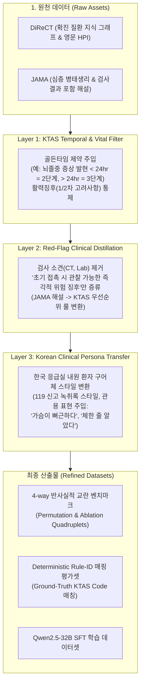

# [개정판 전략 보고서] 임상 도메인 갭 및 언어적 왜곡을 보완한 DiReCT & JAMA 데이터셋 적용 프레임워크

---

## 1. 비판적 검토 반영 및 핵심 해결 과제 (Executive Summary)

제시해주신 피드백은 **"의학적으로 타당하지 않은 AI 연구"가 되는 것을 막아주는 결정적인 임상적 지적**입니다. 

| 비판점 | 핵심 위험 (Failure Mode) | 보완 해결책 (Solution Layer) |
| :--- | :--- | :--- |
| **1. 확진 KG vs 응급 트리아지 룰의 도메인 갭** | 뇌졸중 의심 증상이 "5일 전 발병"인데 2단계로 판정 요구 시 **KTAS 골든타임 규칙(24시간 이내=2단계, 초과=3단계) 위반** | **KTAS Temporal & Vital Mapping Layer** (시간 제약 및 1/2차 고려사항 명시적 보정) |
| **2. 심층 진단 해설 vs 초기 트리아지 근거의 괴리** | 혈액검사/영상 소견 기반의 JAMA 해설과 초기 문진 한 줄 근거의 어휘 불일치 (F1 왜곡) | **Red-flag Clinical Distillation** (사후 검사 소견 배제, 즉각적 생명 위협 징후만 선별 증류) |
| **3. 영문 직역에 따른 언어·문화적 환각** | 어색한 번역투로 인한 문진 현실성 결여, 한국 특유의 내원 표현("체한 것 같다", "뻐근하다") 누락 | **Korean Clinical Persona & 119 Style Transfer** (한국형 응급실/구급 구어체 재작성) |
| **4. 비응급 증상의 상호작용 간섭 위험** | 하벽 심근경색에서의 소화불량처럼, 비응급 후보가 응급 질환의 비전형적 동반 증상일 경우 모델 정답을 오답 처리할 위험 | **Orthogonal Organ-System Constraint** (해부학적/계통적으로 상호 간섭이 완전히 배제된 독립 부위 증상만 페어링) |
| **5. 활력징후(V/S)와 환자 구어 간 교란** | 환자가 "혈압이 200이에요"라고 말하는 비현실성 및 V/S(1차 고려사항) 미통제로 인한 2차 징후 판정 교란 | **V/S - Patient Dialogue Structural Separation** (정상 V/S를 별도 섹션으로 명시하여 2차 징후 추론력만 순수 평가) |
| **6. LLM-Judge의 주관성 및 환각** | 자연어 유사도나 LLM-Judge 채점 시 판정 모델의 자체 주관성/환각 개입 | **Deterministic Rule-ID Matching** (KTAS 가이드라인 고유 룰 코드의 Python Assert 일치 검증 우선) |

---

## 2. 개정된 3-Layer 전처리 파이프라인 아키텍처

원천 데이터(DiReCT, JAMA)가 모델 학습 및 반사실적 테스트셋으로 전환되는 과정에 **3단계 엄밀한 임상 정제 레이어**를 구축합니다.



---

## 3. 구현 전 데이터 오염 방지를 위한 3대 엔지니어링 원칙 (Critical Principles)

### 3.1 원칙 1: 비응급 증상의 계통적 직교성 강제 (Orthogonal Complaints)
비응급 증상이 사실은 응급 질환의 비전형적 동반 징후(Atypical Presentation)인 경우, 모델이 의학적으로 올바른 추론을 했음에도 파이프라인이 오답으로 감점하는 치명적 왜곡이 생깁니다.
* **위험 사례**: 급성 하벽 심근경색(KTAS 2) 환자에게 비응급 증상으로 '소화불량/속쓰림'을 결합하면, 소화불량 자체가 심근경색의 방사 증상이므로 독립된 비응급 증상으로 볼 수 없음.
* **해결 규정 (계통 격리 온톨로지)**:
  * **심혈관계 응급(흉통/호흡곤란)** $\leftrightarrow$ **만성 정형외과(수년 된 무릎 관절통, 발목 염좌)**
  * **신경계 응급(편측마비/조음장애)** $\leftrightarrow$ **만성 피부질환(발가락 무좀, 만성 건선 가려움)**
  * **호흡기계 응급(급성 천식 발작/청색증)** $\leftrightarrow$ **경미 안과 질환(만성 결막염 눈곱)**
  * 상호 인과관계 및 연관성이 $0\%$인 신체 계통(Body Systems) 간에만 1:1 페어링을 허용합니다.

---

### 3.2 원칙 2: 활력징후(V/S)와 환자 구어 발화의 구조적 분리
환자가 입으로 본인의 혈압이나 체온을 정확한 수치로 말하는 것은 실제 응급실 환경과 맞지 않습니다. 또한 V/S(KTAS 1차 고려사항)가 비정상이면 모델이 환자 말의 증상을 볼 필요도 없이 V/S만으로 1~2단계를 찍어버리므로 실험이 무의미해집니다.

* **입력 프롬프트 표준 템플릿**:
  ```text
  [초기 활력징후(1차 고려사항)]: BP 122/78 mmHg, HR 74회/분, RR 16회/분, BT 36.6℃, SpO2 99% (모두 정상 범위)
  [환자 진술(2차 고려사항 대상)]: "선생님, 1시간 전부터 갑자기 혀가 굳는 것처럼 말이 어눌하게 나오고 발음이 꼬여요. 원래 비 올 때마다 쑤시던 왼쪽 무릎도 욱신거리고요."
  ```
* **효과**: 1차 생체징후가 완벽히 정상이므로, 모델은 **오직 환자 진술 내 2차 위험 징후(급성 조음장애 vs 만성 관절통)의 경중**만을 판단하는 순수한 트리아지 추론 능력을 평가받게 됩니다.

---

### 3.3 원칙 3: 평가 시 주관성 배제를 위한 결정론적 룰 ID (Deterministic Rule-ID) 검증
자연어 문장 간 유사도(F1, BLEU)나 LLM-as-a-Judge만 사용하면 채점 모델 자체의 환각과 주관성이 개입합니다.

* **출력 스키마에 KTAS 공식 Rule ID 강제**:
  ```json
  {
    "primary_complaint": "급성 언어 장애 (조음장애)",
    "applied_rule_id": "신경계_409_2차고려_발병24시간이내",
    "rationale": "발병 1시간 이내 급성 신경학적 결손은 뇌졸중 의심 징후로 만성 무릎 통증에 우선하여 2단계 적용",
    "ktas_level": 2
  }
  ```
* **평가 2단계 파이프라인**:
  1. **1차 Deterministic Check (Python Assert)**:
     `output["applied_rule_id"] == ground_truth_rule_id` 및 `output["ktas_level"] == expected_level` 여부를 기계적으로 판정 (신뢰도 100%).
  2. **2차 LLM-Judge Check**:
     1차 룰 코드가 일치한 케이스에 한해서만, `rationale` 문장이 환자에게 설명하기에 의학적으로 매끄럽고 타당한지(Fluency & Medical Coherence)를 1~5점 척도로 보조 채점.

---

## 4. 개정된 4-way 반사실적 데이터셋 구체 예시

```json
{
  "case_id": "CF_STROKE_ORTHOGONAL_001",
  "system_pairing": {
    "urgent_system": "신경계 (급성 뇌졸중 의심)",
    "non_urgent_system": "정형외과계 (만성 무릎 관절통)",
    "orthogonality_verified": true
  },
  "vital_signs": "BP 120/80 mmHg, HR 72회/분, RR 16회/분, BT 36.5℃, SpO2 99%",
  "golden_time": "1시간 전 발병 (< 24시간, KTAS 2단계 부합)",
  "ground_truth_rule_id": "신경계_409_2차고려_발병24시간이내",
  "expected_ktas_level": 2,
  "permutations": {
    "case_original": {
      "patient_dialogue": "선생님, 1시간 전부터 갑자기 혀가 굳는 것처럼 말이 어눌하게 나오고 발음이 꼬이는데, 원래 비 올 때마다 쑤시던 왼쪽 무릎도 계속 욱신거려요.",
      "expected_primary_complaint": "급성 언어 장애 (조음장애)"
    },
    "case_permuted": {
      "patient_dialogue": "선생님, 원래 비 올 때마다 쑤시던 왼쪽 무릎이 계속 욱신거리는데, 1시간 전부터 갑자기 혀가 굳는 것처럼 말이 어눌하게 나오고 발음도 꼬여요.",
      "expected_primary_complaint": "급성 언어 장애 (조음장애)"
    },
    "case_ablate_urgent": {
      "patient_dialogue": "선생님, 원래 비 올 때마다 쑤시던 왼쪽 무릎이 계속 욱신거려서 물리치료 좀 받을 수 있나 왔어요.",
      "expected_primary_complaint": "무릎 통증 (만성)",
      "expected_ktas_level": 5,
      "expected_rule_id": "근골격계_만성통증_경증"
    },
    "case_ablate_non_urgent": {
      "patient_dialogue": "선생님, 1시간 전부터 갑자기 혀가 굳는 것처럼 말이 어눌하게 나오고 발음이 자꾸 꼬여요.",
      "expected_primary_complaint": "급성 언어 장애 (조음장애)"
    }
  }
}
```

---

## 5. 최종 평가 지표 (Quantitative Benchmark Metrics)

1. **Deterministic Rule Accuracy (DRA)**:
   * 모델이 반환한 `applied_rule_id`와 `ktas_level`이 Ground-Truth와 정확히 일치하는 비율 (정량적 기계 검증).
2. **Order Invariance Score (OIR, 순서 불변성)**:
   * Original(A+B)과 Permuted(B+A) 간 주호소 및 Rule ID 일치 비율.
3. **Causal Sensitivity Rate (CSR, 인과적 민감도)**:
   * 치명 증상 제거 시 중증도 하락 성공률 및 비치명 증상 제거 시 중증도 유지율.
4. **Explanation Quality Score (EQS, 보조 지표)**:
   * 정답 케이스에 대해 LLM-Judge가 평가한 근거 설명의 자연스러움 및 신뢰도.
