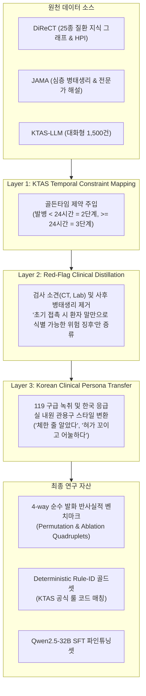
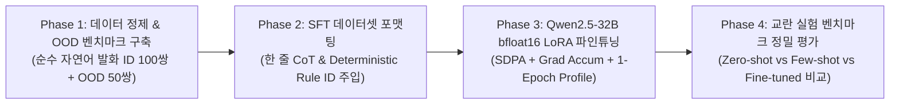

# [연구 계획서] KTAS-LLM 근거-결정 일치도 검증 및 반사실적 교란 실험 (최종 종합 개정안: Pure Clinical NLP)

---

## 1. 연구 개요 및 학술적 독창성

### 1.1 연구 배경 및 문제 정의
실제 응급실 접수창구, 119 구급 신고 전화, 또는 비대면 트리아지 키오스크/챗봇 환경에서 환자는 혈압계를 차기 전에 **오직 자신의 말(자연어 진술)**로 상태를 호소합니다.
환자들은 치명적인 응급 증상과 사소한 만성 질환을 두서없이 복합적으로 말하며, KTAS(한국형 응급환자 분류도구)의 대원칙은 **"가장 위급한 주호소(Highest Acuity Complaint)를 기준으로 최종 단계를 결정한다"**는 것입니다.

본 연구는 바이탈사인 등 정량적 수치 힌트(Confounding Factors)를 완전히 배제하고, **순수 환자 자연어 발화(Pure Patient Utterance)**만을 입력받았을 때 오픈소스 대형 언어 모델(**Qwen2.5-32B-Instruct**)이:
1. 문장 내 증상의 표현 순서에 현혹되지 않고 치명적 증상을 주호소로 일관되게 채택하는지(**Order Invariance**),
2. 치명적 증상이 사라졌을 때만 민감하게 중증도가 완화되는지(**Causal Sensitivity**),
3. 자신이 선택한 주호소와 KTAS 결정 트리 간의 의학적 인과 근거가 일치하는지(**Rationale Faithfulness**)를 체계적으로 검증합니다.

---

## 2. 하드웨어 인프라 및 메모리 대역폭 병목 극복 전략

### 2.1 하드웨어 인프라 (DGX Unified Memory 128GB)
* **GPU / 가속기**: NVIDIA GB10 (CUDA 13.0 지원, Driver 580.95.05)
* **CPU**: ARM64 (aarch64, Cortex-X925 / A725, 20 Cores)
* **메모리**: **128GB 통합 메모리 (가용 메모리: 112GiB 이상)**

### 2.2 메모리 대역폭 병목(Bandwidth Bottleneck) 대응 학습 엔지니어링
통합 메모리는 128GB의 광활한 용량을 제공하지만, HBM 대비 대역폭이 낮아 백프로파게이션 시 메모리 스왑 및 지연이 발생할 수 있습니다. 이를 방지하기 위해 다음과 같은 **정밀 하이퍼파라미터 프리셋**을 고정합니다:
1. **PyTorch SDPA (Scaled Dot-Product Attention) 필수 활성화**: $O(N^2)$ 메모리 접근을 $O(N)$으로 억제하여 I/O 병목 해소.
2. **Gradient Checkpointing 적용**: 활성화 텐서 재계산으로 메모리 풋프린트를 1/3 이하로 압축.
3. **Micro-batching + Gradient Accumulation**:
   * `per_device_train_batch_size = 1` 또는 `2`
   * `gradient_accumulation_steps = 8` 또는 `16` (유효 배치 사이즈 16~32 달성)
4. **1-Epoch 사전 프로파일링 (Warmup Profile)**: 본격적인 훈련 전 100스텝을 먼저 구동하여 Throughput(tokens/sec)과 메모리 안정성을 사전 검증.

---

## 3. 데이터셋 활용 및 도메인 갭 보완 파이프라인

본 연구는 자체 구축된 KTAS 대화 데이터(1,500건)와 국제적 검증 임상 데이터셋(**DiReCT**, **JAMA**)을 결합하되, **도메인 갭(확진 지식 vs 초기 접촉 트리아지)을 극복하는 3단계 임상 정제 레이어**를 거칩니다.



---

## 4. 데이터 무결성 및 실험 왜곡 방지를 위한 4대 핵심 원칙

### 4.1 원칙 1: 비응급 증상의 계통적 직교성 강제 (Orthogonal Complaints)
* **문제**: 하벽 심근경색에서의 소화불량처럼, 비응급 증상이 응급 질환의 비전형적 동반 증상(Atypical presentation)일 경우 모델의 올바른 의학적 판단을 오답으로 감점하는 왜곡 발생.
* **해결 규정**: **해부학적/계통적으로 상호 간섭이 $0\%$인 독립 신체 부위만 페어링**하도록 온톨로지 규칙 강제.
  * 심혈관계 응급(급성 흉통) $\leftrightarrow$ 만성 정형외과(오래된 무릎 관절통)
  * 신경계 응급(급성 조음장애/마비) $\leftrightarrow$ 만성 피부질환(발가락 무좀, 건선)
  * 호흡기계 응급(급성 천식 발작) $\leftrightarrow$ 경미 안과/이비인후과(만성 결막염 눈곱)

### 4.2 원칙 2: 비응급 제거(CSR-Maintain) 시 Masking Effect 방지
* **문제**: 비응급 증상을 지웠을 때, 부수적으로 발생했던 2차 고려사항 점수(Modifier)가 함께 소멸하여 정상적인 다운그레이드가 발생할 수 있음.
* **해결 규정**: CSR-Maintain 평가 대상은 **"비응급 증상이 완전히 고립되어 2차 Modifier에 전혀 영향을 주지 않는 순수 독립 증례(Isolated Orthogonal Case)"**로만 한정하고 메타데이터에 `is_pure_isolated_case: true`를 명시.

### 4.3 원칙 3: 합성 데이터 유출 방지를 위한 OOD 질환 분리 (Data Leakage 차단)
* **문제**: SFT 데이터와 벤치마크 생성에 동일한 LLM/온톨로지가 사용되면, 모델이 인과 논리가 아닌 합성 템플릿의 문장 구조를 암기(Surface Memorization)할 위험 존재.
* **해결 규정 (In-Distribution vs Out-of-Distribution Split)**:
  * **In-Distribution (ID, 100쌍)**: SFT 학습에 포함된 질환군 (신경계-뇌졸중, 심혈관계-흉통 등)
  * **Out-of-Distribution (OOD, 50쌍)**: **SFT 학습셋에 전혀 등장하지 않은 비학습 질환군 (호흡기계-급성 천식 발작, 중독/약물 과다복용, 면역-아나필락시스 등)**을 평가셋으로 배치하여 제로샷 인과 일반화 역량을 입증.

### 4.4 원칙 4: 결정론적 룰 ID (Deterministic Rule-ID) 기반 2단계 채점
* **1차 Deterministic Check (Python Assert)**:
  모델이 반환한 `applied_rule_id` 및 `ktas_level`이 Ground-Truth와 정확히 일치하는지 기계적 검증 (신뢰도 100%).
* **2차 LLM-Judge Check**:
  1차 통과 건에 한해, 모델의 한 줄 `rationale` 문장이 환자에게 설명하기에 의학적으로 타당한지(Fluency & Medical Coherence)를 1~5점으로 보조 채점.

---

## 5. 핵심 실험 설계: 반사실적 교란 벤치마크 (Pure Text Quadruplets)

각 증례는 바이탈사인 없이 **오직 환자의 말(자연어 발화)**만으로 4중 변형(Quadruplet)을 구성합니다:

```json
{
  "case_id": "CF_STROKE_ORTHOGONAL_001",
  "split": "In-Distribution",
  "system_pairing": {
    "urgent_system": "신경계 (급성 뇌졸중 의심)",
    "non_urgent_system": "정형외과계 (만성 무릎 관절통)",
    "orthogonality_verified": true,
    "is_pure_isolated_case": true
  },
  "golden_time": "1시간 전 발병 (< 24시간, KTAS 2단계 부합)",
  "ground_truth_rule_id": "신경계_409_2차고려_발병24시간이내",
  "expected_urgent_ktas": 2,
  "ground_truth_non_urgent_rule_id": "근골격계_만성_경미통증",
  "expected_non_urgent_ktas": 5,
  "permutations": {
    "case_original": {
      "patient_dialogue": "선생님, 1시간 전부터 갑자기 혀가 굳은 것처럼 발음이 자꾸 꼬이고 말이 어눌하게 나와요. 그런데 원래 비 올 때마다 쑤시던 왼쪽 무릎이 오늘도 좀 욱신거려요.",
      "expected_primary_complaint": "급성 신경학적 결손 (뇌졸중 의심)",
      "expected_ktas_level": 2,
      "expected_rule_id": "신경계_409_2차고려_발병24시간이내"
    },
    "case_permuted": {
      "patient_dialogue": "선생님, 원래 비 올 때마다 쑤시던 왼쪽 무릎이 오늘도 좀 욱신거리는데, 그러더니 갑자기 1시간 전부터 혀가 굳은 것처럼 발음이 자꾸 꼬이고 말이 어눌하게 나와요.",
      "expected_primary_complaint": "급성 신경학적 결손 (뇌졸중 의심)",
      "expected_ktas_level": 2,
      "expected_rule_id": "신경계_409_2차고려_발병24시간이내"
    },
    "case_ablate_urgent": {
      "patient_dialogue": "선생님, 원래 비 올 때마다 쑤시던 왼쪽 무릎이 오늘도 좀 욱신거려요.",
      "expected_primary_complaint": "만성 무릎 관절통",
      "expected_ktas_level": 5,
      "expected_rule_id": "근골격계_만성_경미통증"
    },
    "case_ablate_non_urgent": {
      "patient_dialogue": "선생님, 1시간 전부터 갑자기 혀가 굳은 것처럼 발음이 자꾸 꼬이고 말이 어눌하게 나와요.",
      "expected_primary_complaint": "급성 신경학적 결손 (뇌졸중 의심)",
      "expected_ktas_level": 2,
      "expected_rule_id": "신경계_409_2차고려_발병24시간이내"
    }
  }
}
```

---

## 6. 정량적 평가 지표 (Quantitative Benchmark Metrics)

| 지표명 | 수식 및 정의 | 목표치 (ID / OOD) | 검증 의의 |
| :--- | :--- | :--- | :--- |
| **DRA (Deterministic Rule Accuracy)** | $\frac{\text{Correct (Rule ID & KTAS Level)}}{N}$ | $> 90\% \ / \ > 80\%$ | KTAS 가이드라인 룰 코드 직접 준수율 |
| **OIR (Order Invariance Score)** | $\frac{\sum \mathbb{I}(\text{Rule}(A+B) == \text{Rule}(B+A))}{N}$ | $> 98\% \ / \ > 95\%$ | 증상 발화 순서에 대한 불변성 (Primacy/Recency Bias 배제) |
| **CSR-Down (Ablation Sensitivity)** | $\frac{\text{KTAS Level Dropped when Urgent Ablated}}{N}$ | $> 95\% \ / \ > 90\%$ | 치명 증상 제거 시 정상적인 등급 완화 민감도 |
| **CSR-Maintain (Ablation Robustness)** | $\frac{\text{KTAS Level Maintained when Non-urgent Ablated}}{N_{\text{isolated}}}$ | $> 95\% \ / \ > 90\%$ | 비응급 제거 시 중증도 유지 견고성 (Masking Effect 배제) |
| **EQS (Explanation Quality Score)** | 전문의 기준 근거 문장 타당성 (LLM-Judge, 1~5점) | $> 4.2 / 5.0$ | 한 줄 CoT 설명의 임상적 자연스러움 및 설득력 |

---

## 7. 단계별 실행 로드맵 (Action Roadmap)



1. **Phase 1 (데이터 정제 & 벤치마크 구축 - 완료)**:
   * DiReCT 25종 질환 KG에서 계통 직교성을 검증한 응급/비응급 증상 쌍 추출
   * 골든타임 앵커 및 119 구어체 스타일을 적용한 순수 자연어 4-way 반사실적 벤치마크(ID 100쌍 + OOD 50쌍) 구축 완료
2. **Phase 2 (SFT 훈련 데이터셋 포맷팅)**:
   * 기존 KTAS 1,500건 데이터셋의 출력을 `[주호소] -> [Rule ID] -> [1줄 CoT Rationale] -> [KTAS 레벨]` 스키마로 표준화
3. **Phase 3 (Qwen2.5-32B 파인튜닝)**:
   * PyTorch SDPA + Gradient Accumulation 설정을 고정하고 1-Epoch 사전 프로파일링 후 bfloat16 LoRA 학습 실행
4. **Phase 4 (정량 평가 및 논문용 결과 시각화)**:
   * ID와 OOD 데이터셋에서 DRA, OIR, CSR, EQS 지표를 종합 산출하고 비교 분석표 작성
